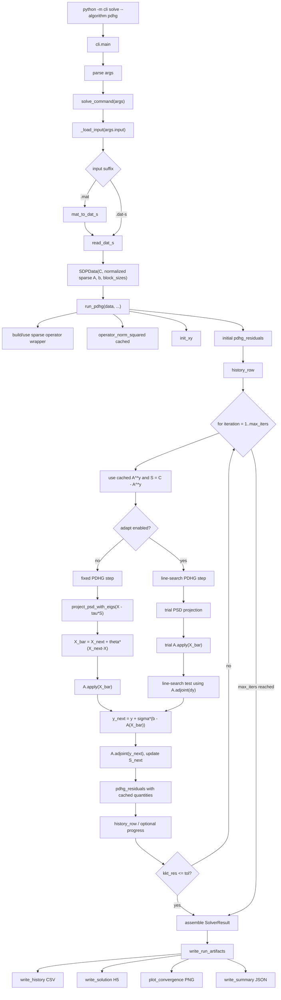

# pdhg-sdp

First-order methods for standard-form semidefinite programming experiments.

This repository solves SDPs of the form

```text
minimize    <C, X>
subject to  A(X) = b
            X >= 0,
```

with dual slack convention

```text
S = C - A^* y.
```

The code is intended for numerical experiments, diagnostics, and reproducible
solver runs. It is not packaged as an installable Python library; commands are
run directly from the repository with `python -m cli`.

## Installation

```bash
uv sync --extra dev
```

Core dependencies are `numpy`, `scipy`, `h5py`, `pandas`, and `matplotlib`.

## Data Format

The primary input format is SDPA sparse `.dat-s`. Positive SDPA blocks are
assembled into one block-diagonal SDP. LP/negative blocks are rejected.

At data boundaries, the affine map `A` is normalized to a sparse CSR matrix in
`svec` coordinates:

- dense tensor `(m, n, n)` -> sparse CSR `svec` operator;
- dense 2D operator matrix -> sparse CSR matrix;
- sparse input -> sparse CSR matrix.

This normalization is representational only. The code does not apply row/column
scaling or equilibration to the numerical problem data.

## Command Line Usage

Solve an SDPA sparse instance with PDHG:

```bash
python -m cli solve \
  --input data/toy.dat-s \
  --algorithm pdhg \
  --tau 0.2 \
  --sigma 0.2 \
  --max-iters 1000 \
  --tol 1e-6 \
  --adapt none \
  --init zero \
  --period 100
```

Solve with ADMM:

```bash
python -m cli solve \
  --input data/toy.dat-s \
  --algorithm admm \
  --rho 1.0 \
  --max-iters 1000 \
  --tol 1e-6 \
  --adapt first-k \
  --adapt-iters 100 \
  --init random \
  --seed 1 \
  --period 100
```

Write artifacts to a custom directory:

```bash
python -m cli solve \
  --input data/toy.dat-s \
  --algorithm pdhg \
  --tau 0.2 \
  --sigma 0.2 \
  --max-iters 100 \
  --output-dir /tmp/pdhg-run
```

Convert supported MATLAB data to SDPA sparse format:

```bash
python -m cli convert-mat --input data/foo.mat
```

Plot and diagnose saved runs:

```bash
python -m cli plot --history results/toy_pdhg_tau=0.2_sigma=0.2_adapt=none_init=zero_history.csv
python -m cli diagnose --solution results/toy_pdhg_tau=0.2_sigma=0.2_adapt=none_init=zero_solution.h5 --check-nd true
python -m cli sparsify-h5 results/toy_pdhg_tau=0.2_sigma=0.2_adapt=none_init=zero_solution.h5
```

## Output Artifacts

Solver runs produce:

- summary JSON (`*_summary.json`);
- solution HDF5 (`*_solution.h5`);
- iteration history CSV (`*_history.csv`);
- convergence plot PNG (`*_convergence.png`).

EPS output is intentionally not produced. Solution HDF5 files store the SDP
operator `A` as sparse CSR data in `svec` coordinates. Sparse `C` and slack
matrices are stored sparsely when beneficial.

## Numerical Implementation Notes

- Affine products `A(X)` and `A^*y` use sparse CSR multiplication after
  normalization.
- Matrix iterates and PSD projection inputs remain dense, because Euclidean
  projection onto the PSD cone requires an eigendecomposition of the symmetric
  matrix.
- PDHG caches `A(X)`, `A^*y`, and `S = C - A^*y` across iterations to avoid
  repeated operator products.
- Fixed-step PDHG performs one PSD projection eigendecomposition per iteration,
  plus at most one additional eigendecomposition for exact residual diagnostics.
- ADMM builds the Gram solver for `A A^*` once during setup and uses one cached
  linear-system solve per iteration.
- Dense Gram setup attempts a Cholesky factorization before falling back to
  SVD/pseudoinverse logic.
- Offline diagnostics, including nondegeneracy checks, may use heavier dense
  eigendecompositions or SVDs because they are not part of the main solver loop.

## Conventions

- `--init zero` starts all algorithm variables at the origin.
- `--init random --seed N` uses symmetric Gaussian matrix iterates and Gaussian
  vector dual iterates.
- Solver progress tables are printed to stderr by default. Use `--period N` to
  change the frequency or `--no-verbose` to suppress them.
- ADMM uses `--rho` as the public name for the paper penalty parameter `sigma`.
- PDHG uses `theta = 1` by default.
- PDHG dual residual is the squared Frobenius distance from
  `S = C - A^* y` to the PSD cone, normalized by `1 + ||C||_F`.
- `diagnose --maxcut` assumes the SDP constraints are `diag(X)=1`.

## Tests

```bash
.venv/bin/python -m pytest -q
```

The light test suite uses:

- `data/toy.dat-s` as the tiny smoke-test SDP (`m=3`, `n=3`);
- `data/pdnd_nosc/pdnd_nosc_n10.dat-s` as the small sparse integration SDP
  (`m=15`, `n=10`).

Generated test artifacts are written to pytest temporary directories. Tests
assert that no new files are created in the repository-level `results/`
directory.

## Repository Layout

```text
cli.py                 command-line interface
core/operators.py      sparse svec operator representation and Gram solvers
core/psd.py            PSD projection and spectral diagnostics
core/residuals.py      objectives and KKT residuals
solvers/pdhg.py        PDHG iterations and line search
solvers/admm.py        ADMM iterations and cached Gram solves
solvers/common.py      shared solver state, history, and progress tables
utils/dataio.py        SDPA/MATLAB input and SDPA output
utils/h5io.py          HDF5 dense/sparse storage helpers
utils/output.py        JSON, HDF5, and CSV run artifacts
utils/plotting.py      PNG convergence plots
utils/diagnostics.py   solution diagnostics and nondegeneracy checks
tests/                 lightweight regression tests
```

## PDHG Call Flow


